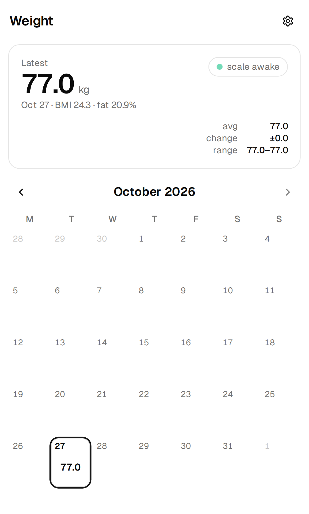

# sscale

**Self-hosted weight tracking for the HUAWEI Scale 3.**

`sscale` reads weigh-ins directly from a Huawei Scale 3 over Bluetooth LE, stores them in SQLite, and serves an installable calendar web app plus a REST API. It runs as a single Docker image and includes a Helm chart for Kubernetes.

[](https://github.com/imdonix/hw-scale-app/actions/workflows/docker-publish.yml)
[](https://hub.docker.com/r/imdonix/hw-scale-app)

<p align="center">
  
</p>

## Features

- **Automatic capture** — the daemon listens for the scale to wake, connects once, saves the weigh-in and disconnects so the scale can sleep.
- **Full body composition** — weight, BMI, fat, water, muscle, bone, lean mass, protein, BMR and visceral fat, computed from the scale's impedance reading.
- **One calendar, no account** — month view with trends, daily changes and per-reading details. Installable as a PWA.
- **Filters out other people** — stray readings are hidden automatically and can be restored or deleted with one tap.
- **REST API and live session feed** — everything the web app uses is available over HTTP/SSE.
- **Runs anywhere** — Docker Compose on a Linux box, or the included Helm chart on a Kubernetes cluster.

## Requirements

- A Linux host with a Bluetooth LE adapter and [BlueZ](https://www.bluez.org/) running (`bluetoothd`).
- Docker with the Compose plugin (or Kubernetes for the Helm chart).
- The scale's pairing secrets in `keys.json` (see [keys.json](TECHNICAL.md#keysjson)).
- The host must be within Bluetooth range of the scale.

Only one process may own the scale connection, so `sscale` should be the only thing talking to it while running.

## Setup

### 1. Prepare the host

Make sure Bluetooth is enabled and the adapter is up:

```sh
sudo apt-get install -y bluez
sudo systemctl enable --now bluetooth
bluetoothctl show        # Powered: yes
```

Clone the repository:

```sh
git clone https://github.com/imdonix/hw-scale-app.git
cd hw-scale-app
```

### 2. Add your keys

Create `keys.json` in the repository root with the scale's address and pairing secrets:

```json
{
  "address": "AA:BB:CC:DD:EE:FF",
  "model": "HUAWEI SCALE 3",
  "cak": "…32 hex characters…",
  "c1": "…32 hex characters…",
  "c2": "…32 hex characters…",
  "height_cm": 178,
  "birthdate": "1990-01-01",
  "sex": "male"
}
```

`address`, `cak`, `c1` and `c2` are required. The profile fields seed the initial settings; you can change them later in the web app. Treat this file as a secret — it is gitignored.

### 3. Build and pair

```sh
docker compose build     # builds the web app + Go binary, runs the tests
./sscale pair            # step on the scale when it appears
```

### 4. Run it

```sh
./sscale                 # start the daemon in the background
./sscale apikey          # print the API key for the web app
```

Open **http://SERVER:8090** and enter the API key. On iOS: Safari → Share → **Add to Home Screen** for the full-screen app.

Useful launcher commands:

| Command | |
|---|---|
| `./sscale` / `./sscale -f` | start in the background / foreground |
| `./sscale stop`, `./sscale logs -f` | stop the daemon / follow its log |
| `./sscale status`, `./sscale history` | inspect the daemon and recorded readings |
| `./sscale scan`, `./sscale once` | list nearby scales / capture one weigh-in |
| `./sscale apikey --rotate` | rotate the web/API key |

## Kubernetes

The Helm chart lives in [`k8s/`](k8s/README.md). It pins the pod to the node with the Bluetooth adapter and mounts the host's D-Bus socket.

```sh
kubectl create namespace sscale
kubectl -n sscale create secret generic sscale-keys --from-file=keys.json=./keys.json
helm upgrade --install sscale ./k8s -n sscale
```

## Configuration

The most common settings can be set in the environment or in `docker-compose.yml`:

| Variable | Default | |
|---|---|---|
| `SSCALE_PORT` | `8090` | host port for the web app (Compose only) |
| `SSCALE_API_KEY` | generated | fixed API key instead of the generated one |
| `SSCALE_ADAPTER` | first adapter | Bluetooth adapter, e.g. `hci0` |
| `SSCALE_LOG_LEVEL` | `info` | `debug`, `info`, `warn`, `error` |
| `SSCALE_TLS_CERT`, `SSCALE_TLS_KEY` | — | serve HTTPS directly |

See [TECHNICAL.md](TECHNICAL.md#configuration) for every option, including scan/cooldown tuning and TLS.

## Documentation

- [TECHNICAL.md](TECHNICAL.md) — protocol details, filtering, REST API, data layout, full configuration, development and troubleshooting.
- [k8s/README.md](k8s/README.md) — Kubernetes/Helm deployment.

## License

The protocol handling and body-composition coefficients are ported from [openScale](https://github.com/oliexdev/openScale) (GPL-3.0-or-later); treat this project accordingly.
